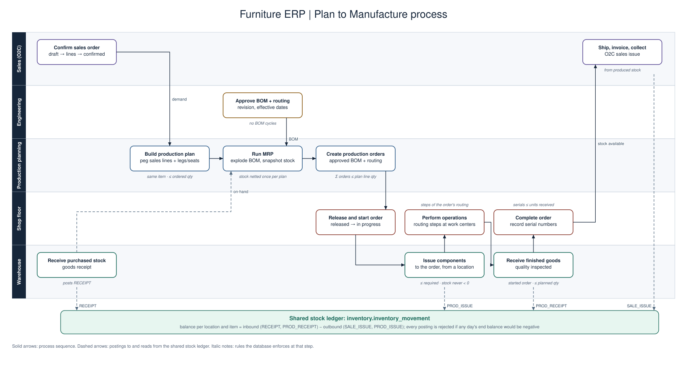
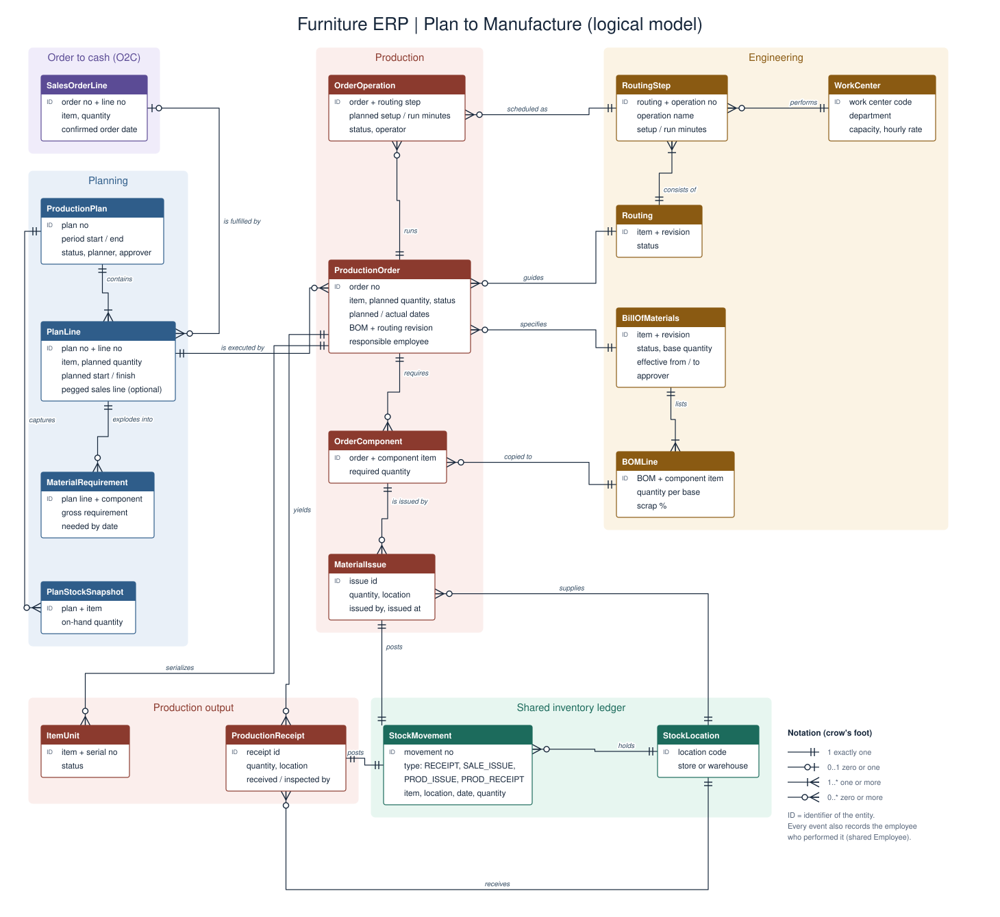

# Furniture ERP Plan to Manufacture Logical Model

The Plan to Manufacture (P2M) cycle turns confirmed customer demand into finished furniture. It covers product engineering (bills of materials and routings), production planning with material requirements planning (MRP), production orders on the shop floor, and the stock movements that consume components and receive finished goods.

P2M does not keep its own copy of master data. It runs in the same database as Order to Cash (O2C) and uses:

- the shared masters `public.item`, `public.employee`, `public.department`, `public.customer` and `public.supplier` (`db_init.sql`);
- O2C sales orders as the source of customer demand (`sales.sales_order_line`);
- the O2C stock ledger `inventory.inventory_movement` for every stock change. P2M adds the `PROD_ISSUE` and `PROD_RECEIPT` movement types, so a table produced by P2M is shipped and invoiced by O2C from the same balance.

## Diagrams

| Diagram | Shows |
| --- | --- |
| [`p2m-process-flow.svg`](p2m-process-flow.svg) | The P2M process across sales, engineering, planning, shop floor and warehouse, with the rules enforced at each step and the postings to the shared ledger |
| [`p2m-logical-model.svg`](p2m-logical-model.svg) | Entities, identifiers and relationships in crow's-foot notation |
| [`p2m-er-diagram.svg`](p2m-er-diagram.svg) | Physical tables with their primary, unique and foreign keys |





## Relations and Keys

Shared relations are listed first; their attributes are described in `o2c-data-dictionary.md`.

| Relation | Identifier | Foreign keys and principal attributes |
| --- | --- | --- |
| `Item` (shared) | `item_id` | Item code, category, unit of measure, roles (purchasable, manufacturable, consumable, sellable, serialized) |
| `Employee` (shared) | `employee_id` | Records who created, approved, issued, received or operated |
| `Department` (shared) | `department_id` | Owner of work centers |
| `SalesOrderLine` (O2C) | `order_line_id` | Confirmed customer demand: item and ordered quantity |
| `StockLocation` (shared) | `location_id` | Store or warehouse |
| `StockMovement` (shared) | `movement_id` | Ledger entry with exactly one source: goods-receipt line, sales line, material issue or production receipt |
| `BillOfMaterials` | `bom_id` | `item_id` → `Item`, revision, status, base quantity, effective dates, approver |
| `BOMLine` | `bom_line_id` | `bom_id` → `BillOfMaterials`, `component_item_id` → `Item`, quantity per base, scrap % |
| `WorkCenter` | `work_center_id` | `department_id` → `Department`, code, daily capacity, hourly rate |
| `Routing` | `routing_id` | `item_id` → `Item`, revision, status |
| `RoutingStep` | `routing_operation_id` | `routing_id` → `Routing`, `work_center_id` → `WorkCenter`, operation number, setup and run minutes |
| `ProductionPlan` | `production_plan_id` | Plan number, period, status, planner and approver |
| `PlanLine` | `production_plan_line_id` | `production_plan_id` → `ProductionPlan`, `item_id` → `Item`, optional (`sales_order_line_id`, `item_id`) → `SalesOrderLine`, quantity and dates |
| `MaterialRequirement` | `material_requirement_id` | `production_plan_line_id` → `PlanLine`, `component_item_id` → `Item`, gross requirement, needed-by date |
| `PlanStockSnapshot` | (`production_plan_id`, `item_id`) | On-hand stock of one component captured once for the plan |
| `ProductionOrder` | `production_order_id` | (`production_plan_line_id`, `item_id`) → `PlanLine`, (`bom_id`, `item_id`) → `BillOfMaterials`, (`routing_id`, `item_id`) → `Routing`, quantity, status, planned and actual dates |
| `OrderComponent` | `production_order_component_id` | (`production_order_id`, `bom_id`) → `ProductionOrder`, (`bom_id`, `component_item_id`) → `BOMLine`, required quantity |
| `OrderOperation` | `production_order_operation_id` | (`production_order_id`, `routing_id`) → `ProductionOrder`, (`routing_operation_id`, `routing_id`) → `RoutingStep`, planned minutes, status, operator |
| `MaterialIssue` | `material_issue_id` | (`production_order_id`, `component_item_id`) → `OrderComponent`, `location_id` → `StockLocation`, quantity, issued by and at |
| `ProductionReceipt` | `production_receipt_id` | `production_order_id` → `ProductionOrder`, `location_id` → `StockLocation`, quantity, received and inspected by |
| `ItemUnit` | `item_unit_id` | (`production_order_id`, `item_id`) → `ProductionOrder`, serial number, status |

The composite foreign keys carry the item, BOM or routing along with the parent key. This lets the database itself guarantee that a production order makes the same item as its plan line, BOM and routing, and that its components and operations come only from that BOM and routing.

## Cardinalities and Business Rules

- **Engineering.** An item has zero or more BOM revisions and routings; each revision belongs to one manufacturable item. A BOM lists one or more consumable components, each at most once. A routing consists of one or more steps, each performed at one work center. No item may appear in its own BOM structure at any depth.
- **Demand.** A sales order line is fulfilled by zero or more plan lines. A pegged plan line plans the same item, the order must be confirmed and dated on or before the planned start, and the total planned for the line cannot exceed the ordered quantity. Plan lines without a sales line represent dependent demand, such as table legs and chair seats.
- **Planning.** A plan contains one or more lines inside its period. MRP explodes each line through the BOM effective on its start date (quantity ÷ base quantity × quantity per × (1 + scrap %)). Stock is captured once per plan and component and netted against the plan's total demand.
- **Production orders.** A plan line is executed by zero or more production orders whose non-cancelled quantity does not exceed the line. Each order uses an approved BOM effective on its planned start and an approved routing. Starting an order requires an actual start date; completing it requires a finish date.
- **Material.** Components are issued only to released or in-progress orders, only for that order's components, and in total up to the required quantity. Each issue posts exactly one `PROD_ISSUE` movement at its location.
- **Output.** Finished goods are received only from started orders, not before the actual start, and in total up to the planned quantity. Each receipt posts exactly one `PROD_RECEIPT` movement. Serialized items get one `ItemUnit` per received unit at most.
- **Stock.** Every outbound movement, from either O2C or P2M, is rejected if the balance at that location would be negative at the end of any business date, including backdated postings. Posted issues, receipts and movements are immutable.

## MRP Netting

Gross requirements are stored per plan line, but on-hand stock is captured once per plan. `planning.material_requirement_net` subtracts the stock from the plan's total demand. The previous design stored on-hand stock on every requirement row, so the same stock was subtracted once per plan line and shortages were understated.

| Component | Plan lines using it | Total gross | On hand | Net (now) | Net (previous design) |
| --- | --- | --- | --- | --- | --- |
| SM-0002 varnish (LT) | 5 | 34.650 | 25 | **9.650** | 0 |
| HM-0002 MDF board | 2 | 43.575 | 30 | **13.575** | 9.375 |
| YM-0001 table leg | 2 | 44 | 0 | **44** | 30 |

On-hand stock is now read from the ledger when MRP runs instead of being typed in. The previous-design column uses the old hard-coded stock, which included 10 table legs; the legs now come only from production, so their stock at planning time is 0.

## Example Transaction

The sample data in `p2m-database.sql` follows one plan, `PP-2026-11`, from demand to stock:

1. Opening stock for six purchased materials arrives on 2026-10-20 through O2C goods receipts at the `DEPO-ANA` warehouse.
2. Three O2C sales orders are confirmed: 40 chairs and 10 tables for a hotel, 25 desks for a school, and 1 table for an individual customer (`SO-2026-0003`).
3. The plan pegs four lines to those sales lines and adds dependent demand for 44 table legs and 40 chair seats. MRP explodes 19 requirement rows and takes one stock snapshot.
4. `UE-2026-0001` makes the 44 legs: components are issued on 10-27, the legs are received into stock on 11-03 and the order is completed.
5. `UE-2026-0002` makes the single table from 11-04. It draws 4 of the legs just produced. The table is received on 11-10 with serial number `MM1-2026-000001`.
6. `UE-2026-0003` (seats) is in progress; the chair, 10-table and desk orders are planned.

`p2m-business-cases.sql` continues the example through O2C: the table is shipped on 11-12 from the stock P2M produced, invoiced for 9,800 TRY and paid. Shipping it on 11-09, before it was produced, is rejected for insufficient stock.

## Shared Integration Contract

| Area | Agreement | P2M application |
| --- | --- | --- |
| Master identity | One `public.item`, `public.employee`, `public.department`, `public.customer` and `public.supplier`. Seed scripts resolve rows by business code. | P2M adds its planner (E-0008) and warehouse employee (E-0009) by `employee_no` with `ON CONFLICT DO NOTHING`. It does not create master tables. |
| Customer demand | O2C owns sales orders. | Plan lines reference `sales.sales_order_line` with a composite (line, item) key and use `sales.lock_confirmed_order` to require a confirmed order. |
| Stock ledger | One `inventory.inventory_movement`. Positive quantities in the item base unit; the type gives the direction through `inventory.signed_quantity`. | P2M adds `material_issue_id` and `production_receipt_id`, widens the type and source checks, and posts through triggers on its own documents. Direct ledger inserts must match the source document. |
| Inbound purchases | O2C goods receipts are the only path for purchased stock until P2P is rebuilt. | P2M opening stock is loaded through `inventory.goods_receipt`. |
| Quantities and dates | `NUMERIC(12,3)` quantities in the ledger, `NaN` rejected, `DATE` business dates. | Issue and receipt quantities use ledger precision. Timestamps on issues and receipts are posted to the ledger as their dates. |
| Employees and departments | H2R will own employee assignments, supervisors and department managers. | P2M records the acting employee on each document and the owning department on each work center only. |

## PostgreSQL Prototype

Install on a fresh database in this order:

```
db_init.sql  ->  o2c-database.sql  ->  p2m-database.sql
then any of: o2c-demo.sql, o2c-business-cases.sql, p2m-business-cases.sql
```

`p2m-database.sql` runs in one transaction. `p2m-business-cases.sql` rolls back everything it creates. The O2C demo and business cases pass with P2M installed, and P2M installs cleanly after the O2C examples have been committed.

| Physical object | Purpose and constraints |
| --- | --- |
| `engineering.bom`, `engineering.bom_line` | Recipe revisions with approval, effective dates and scrap. Components must be consumable; the BOM structure must be acyclic. |
| `engineering.work_center`, `engineering.routing`, `engineering.routing_operation` | Production resources and the operation sequence per item revision. |
| `planning.production_plan`, `planning.production_plan_line` | Plan period and the items to produce; optional peg to an O2C sales line. |
| `planning.material_requirement`, `planning.plan_stock_snapshot`, `planning.material_requirement_net` | Gross requirements per line, one stock snapshot per plan, and the net requirement view. |
| `production.production_order` | Order for one plan line with an approved BOM and routing; quantity is capped by the plan line. |
| `production.production_order_component`, `production.production_order_operation` | Requirements and operations copied from the order's own BOM and routing. |
| `production.material_issue`, `production.production_receipt` | Stock documents that post `PROD_ISSUE` and `PROD_RECEIPT` movements; immutable once posted. |
| `production.item_unit` | Serial numbers of serialized items, no more than the quantity received. |
| `inventory.inventory_movement` (extended) | Shared ledger with the two production movement types and their source columns. |

Field-level definitions are in `p2m-data-dictionary.md`.

## Business Rule Checks

`p2m-business-cases.sql` runs 33 operations that must be rejected, verifies MRP and stock figures, and runs the P2M → O2C hand-off.

| Area | Rejected operations |
| --- | --- |
| Planning | Plan line item different from its sales line; dates outside the plan period; quantity above the sales line; draft sales order; start before the order date; non-manufacturable item; shrinking the plan period below its lines; `NaN` quantity |
| Engineering | BOM listing its own item; two-level and three-level BOM cycles |
| Production orders | Draft BOM; quantity above the plan line; operation from another item's routing; component outside the order's BOM; switching the BOM of an order that already has components |
| Material issues | Order not released; quantity above the requirement; completed order; location without stock; backdated issue before the opening stock; `NaN` quantity; changing a posted issue |
| Production receipts | Order not started; quantity above plan; receipt before the actual start; `NaN` quantity; deleting a posted receipt; more serial numbers than units received |
| Shared ledger | Production movement without a source document; posting a production receipt twice; shipping a table before it was produced; shipping a table that was never produced |

## Open Design Decisions

- **Requested delivery date.** P2M's old sales order had one. O2C's sales order doesn't, so the date was dropped; plan lines carry the planned finish date instead. Add the date to `sales.sales_order` if delivery promising is needed.
- **Status language.** P2M status values are in Turkish (`TASLAK`, `ONAYLANDI`, `DEVAM_EDIYOR`); O2C uses English (`DRAFT`, `CONFIRMED`). The team should pick one.
- **Shipping serialized units.** An O2C sales issue does not yet mark the shipped `production.item_unit` as `SEVK_EDILDI`.
- **Plan approval.** An approved plan can still be edited; locking approved plans and status transitions for orders and operations are not enforced yet.
- **Issue tolerance.** Issues are capped at exactly the required quantity. A tolerance percentage for over-issue can be added if the shop floor needs it.
- **Moved to other modules.** Supplier price lists (`item_supplier`) belong to P2P. Employee departments, supervisors and department managers belong to H2R. The unit and category lookup tables were dropped in favour of the check lists on `public.item`.

## Regenerating the Documentation

The data dictionary and the diagrams are generated, so they stay in step with the schema:

```
# data dictionary: needs a database with db_init.sql, o2c-database.sql and p2m-database.sql installed
PGHOST=... PGPORT=... PGUSER=... PGDATABASE=... python3 database/docs/tools/gen_p2m_data_dictionary.py

# diagrams: no dependencies beyond Python 3
python3 database/docs/tools/gen_p2m_diagrams.py
```

Column meanings and trigger descriptions are maintained in `gen_p2m_data_dictionary.py`. The generator stops with an error if a column or trigger has no description.
